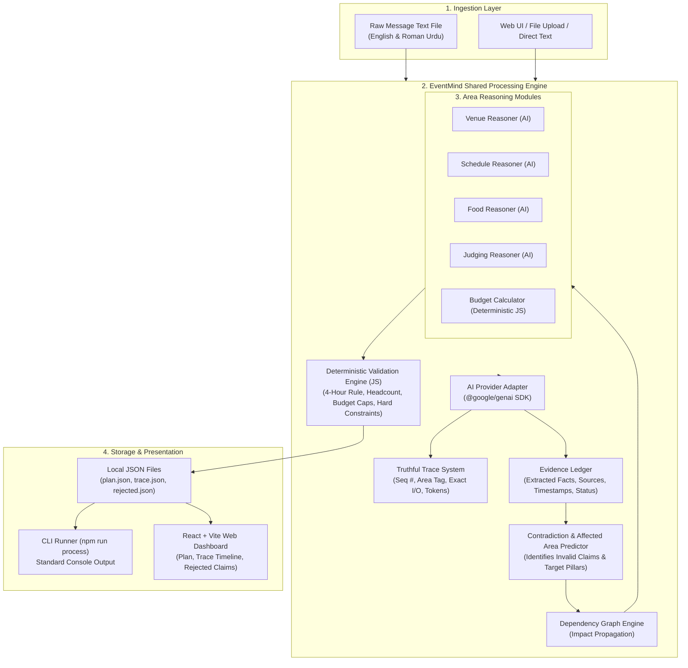

# EventMind AI — Project Specification

## 1. Executive Summary & Objective

**EventMind AI** is an intelligent, constraint-aware event planning agent built for the **Mind to Machine Hackathon**. The system ingests approximately ten unstructured, real-world messages written in a mixture of English and Roman Urdu (sourced from WhatsApp messages, emails, and notices) containing noise, outdated information, contradictions, and erroneous claims.

The agent parses and synthesizes these inputs to produce an end-to-end, deterministic, validated **4-hour physical event plan for Islamabad**, covering five critical pillars:
1. **Venue** (location, capacity, AV/facilities, logistical constraints)
2. **Schedule** (strictly 4 hours / 240 minutes, sequential, gap-free, logically ordered)
3. **Food** (catering, refreshments, dietary considerations, headcount-aligned)
4. **Judging** (judges panel, evaluation rubric, presentation slots, team allocations)
5. **Budget** (deterministic arithmetic calculation of all costs vs. financial caps)

The system is delivered as a unified full-stack application within a single repository, featuring a shared processing engine that drives both a deterministic CLI command (`npm run process`) and an interactive React web dashboard.

---

## 2. Core Architectural Principles & System Design



### Architectural Guarantees:
1. **Single Repository & Unified Workspace**: No fragmented packages or disparate teammate repos.
2. **Shared Processing Engine**: The exact same processing service, prompt templates, and validation logic run whether triggered by the CLI or the React UI.
3. **Zero Hardcoded Domain Facts**: The system never contains preset facts (e.g. no hardcoded venue names, budget limits, or attendee counts). All facts must be extracted dynamically from the supplied input messages.
4. **Separation of Concerns (AI vs. Deterministic JS)**:
   - **AI Handles**: Natural language understanding, Roman Urdu translation, intent disambiguation, fact & constraint extraction, contradiction detection, affected-area prediction, and creative plan synthesis.
   - **JavaScript Handles**: Arithmetic, budget totals, capacity bounds, duration arithmetic, judge slot allocation, schedule continuity, hard constraint enforcement, and token tallying.
5. **Truthful & Verifiable Trace System**: Every single call to Gemini records exact model name, sequence number, area tag, exact prompt payload, exact output response, input token count, output token count, and latency.

---

## 3. Pillar Specifications

### 3.1. Venue
- **Location**: Must be a verified physical venue in **Islamabad**.
- **Capacity**: Must accommodate all participants, mentors, organizers, and judges with appropriate buffer.
- **Logistics**: Requires high-speed internet, power backups, projector/AV setup, and seating arrangements suitable for a hackathon.

### 3.2. Schedule
- **Duration**: **Strictly 4 hours (240 minutes)**. Any plan shorter or longer is rejected by the validation engine.
- **Continuity**: No overlapping sessions or unallocated dead time.
- **Core Components**:
  - Participant arrival & registration (e.g., 20-30 mins)
  - Opening ceremony & keynote/problem briefing (e.g., 20-30 mins)
  - Working / hacking / mentorship sessions
  - Pitching / project demonstration & judging
  - Scoring tabulation & closing award ceremony

### 3.3. Food
- **Offerings**: Refreshments, tea/coffee, snacks, or meal (e.g., Hi-Tea or lunch/dinner depending on event window).
- **Dietary & Cultural Requirements**: 100% Halal; vegetarian/allergen options accounted for if specified in messages.
- **Logistics**: Timing aligned with the schedule breaks; quantities matched strictly to attendee headcount.

### 3.4. Judging
- **Panel**: Evaluated by qualified judges based on domains mentioned in input.
- **Allocation Arithmetic (JS)**:
  $$\text{Slot per team} = \frac{\text{Total Judging Window (minutes)}}{\text{Number of Teams}}$$
  Includes presentation time (e.g. 3-5 mins) + Q&A (e.g. 2 mins) + transition.
- **Rubric**: Standardized criteria (e.g., Innovation, Technical Execution, Feasibility, Presentation).

### 3.5. Budget
- **Calculation Type**: **Pure Deterministic JavaScript (0 AI Model Calls)**.
- **Formula**:
  $$\text{Total Budget} = \text{Venue Cost} + \text{Catering Cost} (\text{Cost per Head} \times N) + \text{AV/Logistics} + \text{Prizes/Swag} + \text{Contingency Buffer}$$
- **Constraint Enforcement**: Must not exceed the extracted budget ceiling. If costs exceed ceiling, flag as constraint violation.

---

## 4. Multilingual & Roman Urdu Ingestion Strategy

Messages in Pakistan often mix English and Roman Urdu within the same sentence (code-switching). The reading model is prompted with bilingual comprehension instructions to handle common Roman Urdu expressions:
- **Catering / Food**: *"khana"*, *"biryani"*, *"hi-tea"*, *"chai biscuit"*, *"refreshments ka intezam"*
- **Venue**: *"jagah"*, *"hall chota hai"*, *"Islamabad mein"*, *"genset / bijli ka masla"*, *"seating capacity barhao"*
- **Schedule**: *"waqt"*, *"timing tabdeel ho gayi"*, *"late start hoga"*, *"namaz break"*
- **Budget**: *"paisa"*, *"itna kharcha nahi kar saktay"*, *"budget barh gaya"*, *"lakh"*
- **Contradictions / Corrections**: *"pehlay wala cancel samjho"*, *"ye ghalat hai"*, *"updated info ye hai"*

---

## 5. Incremental Update & Dependency Strategy

### 5.1. Update Rules
- New messages are appended to the ledger.
- A **single reading model call** evaluates the delta:
  1. Identifies valid new facts or overrides.
  2. Identifies contradictions/erroneous claims and logs them with reasoning to `rejected.json`.
  3. Predicts affected areas from `['venue', 'schedule', 'food', 'judging']`.
- **Pre-execution Notification**: The engine outputs `[PREDICTION] Affected areas: ['...', '...']` before triggering area calls.
- **Strict Model Call Cap**:
  - Maximum **5 model calls per update**: 1 reading call + up to 4 area calls.
  - Budget is recalculated purely in JS (0 calls).
- **Execution Time Limits**:
  - Initial Run: $\le 120$ seconds.
  - Update Run: $\le 60$ seconds.

### 5.2. Dependency Graph
```
           [New Messages]
                 │
                 ▼
       (1. Reading Model Call)
                 │
       ┌─────────┴─────────┐
       ▼                   ▼
 [Rejected Claims]   [Valid Facts]
                           │
       ┌───────────────────┼───────────────────┐
       ▼                   ▼                   ▼
[Venue Reasoner]   [Schedule Reasoner]   [Food Reasoner]
       │                   │                   │
       └─────────┬─────────┴─────────┬─────────┘
                 ▼                   ▼
          [Judging Reasoner]  [Deterministic JS Budget]
                 │                   │
                 └─────────┬─────────┘
                           ▼
             [Deterministic JS Validation]
                           │
                           ▼
               [Saved Plan & Full Trace]
```

---

## 6. Proposed Directory Structure

```
eventmind-ai/
├── package.json               # Root scripts, concurrently/npm run process
├── .env.example               # GEMINI_API_KEY, GEMINI_MODEL
├── .gitignore
├── README.md                  # Setup instructions and operational documentation
├── PROJECT_SPEC.md            # Architecture, domain specifications, rules
├── API_CONTRACT.md            # REST API & CLI interface definitions
├── ACCEPTANCE_CHECKLIST.md    # Scoring rubric verification checklist
├── data/                      # Input message files
│   ├── sample_messages.txt    # Default or provided message set
│   └── update_messages.txt    # Delta message set for updates
├── output/                    # Persistent output artifacts
│   ├── plan.json              # Latest valid event plan
│   ├── trace.json             # Full model call trace ledger
│   └── rejected.json          # Detected invalid/conflicting messages
├── backend/                   # Node.js Express ES Modules Backend
│   ├── package.json
│   ├── index.js               # Express server entry point
│   ├── cli.js                 # Standalone CLI runner invoked by npm run process
│   └── src/
│       ├── config.js          # Environment, model settings, constants
│       ├── core/
│       │   ├── engine.js      # Unified shared processing engine
│       │   ├── ledger.js      # Evidence ledger manager
│       │   ├── dependency.js  # Affected-area prediction & dependency graph
│       │   ├── validator.js   # Deterministic JS validation engine
│       │   └── budget.js      # Deterministic JS budget calculator
│       ├── ai/
│       │   ├── adapter.js     # Official Google Gen AI SDK wrapper
│       │   ├── prompts.js     # Modular system & area prompts
│       │   └── tracer.js      # Truthful trace recorder with token telemetry
│       ├── routes/
│       │   └── api.js         # REST endpoints for React dashboard
│       └── utils/
│           ├── file-io.js     # Safe reading & atomic writing of JSON/txt files
│           └── logger.js      # Formatted console logging
└── frontend/                  # React + Vite + Tailwind Dashboard
    ├── package.json
    ├── vite.config.js
    ├── index.html
    └── src/
        ├── App.jsx            # Main dashboard container
        ├── main.jsx
        ├── index.css          # Tailwind CSS styling
        ├── services/
        │   └── api.js         # Axios client connected to backend
        └── components/
            ├── Navbar.jsx     # Header with status & token summary counter
            ├── PlanView.jsx   # 5-Pillar event plan cards
            ├── TraceView.jsx  # Truthful model trace timeline & telemetry
            ├── RejectedView.jsx # Collapsible rejected/conflicting claims list
            └── MessageInput.jsx # Ingest new messages & trigger updates
```

---

## 7. Unknowns and Parsing Edge Cases

1. **Message Delimiters**: Raw text files may separate messages by lines, timestamps, blank lines, or headers (`Message 1:`, `From: ...`). The parser must support regex-based multi-format segmentation while preserving raw text.
2. **Ambiguous Timestamps**: Messages may lack explicit dates (e.g. *"Kal subah 10 baje"*). Chronology must be inferred from sequential message order and sender authority.
3. **Phonetic Roman Urdu Variations**: Words like *"nahin"*, *"nai"*, *"ni"*, *"nhi"* or *"theek"*, *"thk"*, *"sahi"* require semantic understanding rather than keyword matching.
4. **Authoritative Overrides**: A message from an organizer or lead (e.g., *"Event Lead"*, *"Asif"*, *"Patron"*) supersedes informal opinions or outdated participant queries.
